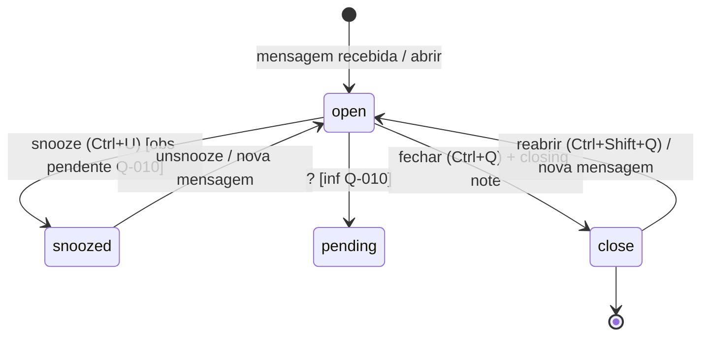

# E-002 Conversation
Product term: Conversation · Parent: E-001 Contact · Status: draft

## Fields

| Field | Type | Required | Default | Constraints or enum | Source |
|---|---|---|---|---|---|
| contactId | number | sim | — | FK → E-001 | [doc SRC-028] |
| id (conversationId) | number | sistema | — | observado em /chat-activity | [net EV-007] |
| status | enum | sim | open | público: open/close; **interno inclui `pending`** | [net EV-007] [doc SRC-028] |
| assignee (assigneeUserId) | User\|null | não | null | ver E-005 | [net EV-007] |
| snoozeTill | number\|null | não | null | epoch — conversa adiada (snooze) | [net EV-007] |
| autoCloseTill | number\|null | não | null | epoch — fechamento automático agendado | [net EV-007] |
| isSurveyOngoing | boolean | sistema | false | CSAT em andamento | [net EV-007] |
| opened | number | sistema | — | epoch (s) | [doc SRC-030] |
| closed | number\|null | sistema | null | epoch (s) | [doc SRC-030] |
| category | string | não | — | categoria da closing note ao fechar (ver E-010) | [doc SRC-028] |
| summary | string | não | — | resumo (closing note) ao fechar | [doc SRC-028] |

> Confirmado por rede [net EV-007]: status **`pending`** existe; **snooze** (`meta.snoozeTill`) e **auto-close** (`meta.autoCloseTill`) são reais (campos em `contact.meta`). Resolve parte do Q-010.
> Auto-close configurável (Settings > Conversas): "Fechar após N **dias** de inatividade; novas respostas reabrem a conversa". [obs EV-017]

## Relations

| Relation | Target | Cardinality | On delete | Source |
|---|---|---|---|---|
| contato | E-001 Contact | N—1 | cascade? | [doc SRC-028] |
| assignee | E-005 User | N—1 | set null | [doc SRC-028] |
| closing note | E-010 ClosingNote | N—o1 | — | [doc SRC-028] |

## Lifecycle

Estados `pending`/`snoozed` aparecem na UI mas não na API (Q-010); diagrama a validar no deep dive do Inbox.

## System fields

| Field | Set when | Source |
|---|---|---|
| opened | ao abrir | [doc SRC-030] |
| closed | ao fechar | [doc SRC-030] |

## Rules

- (deep dive F-011: o que exige closing note ao fechar; reabertura por nova mensagem; snooze)

## Not tested

- Semântica exata de `pending` (quando entra) e disparo do auto-close.
- Se closing note (category/summary) é obrigatória ao fechar.
- Reabertura automática ao chegar nova mensagem numa conversa fechada.
- Múltiplas conversas simultâneas por contato (uma ativa por vez?).
