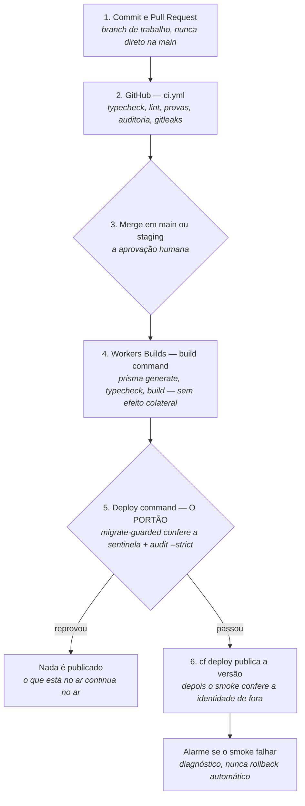

# 15 — Arquitetura definitiva: GitHub × Workers Builds, branches, ambientes, rollback

* **Autor:** André (venn360) · análise e execução com revisão multi-lente (EGM, 6 revisores)
* **Data:** 2026-11-01 · fatos medidos nesta data, salvo quando datados
* **Escopo:** os 7 projetos — 3 apps (Odontobox, Stagent, Conecta) + 4 sites (venn360, advogadamohs, janainaleiteadv, visuallaw)
* **Decisões do André que este documento implementa:** zero compra de créditos de GitHub Actions (permanente); aprovação humana de produção = merge em `main`; GitHub Pro recusado; Workers de produção dos clones com nome limpo (`stagent`, `conecta`); staging da Odontobox criado após esta execução.

## 1. Veredito

**Cada plataforma fica só com o que faz melhor, e a duplicação morre.** O GitHub guarda código, Pull Requests e verificação barata (~2 min por PR) — zero builds de Worker, zero deploys, zero segredos de runtime. O Cloudflare Workers Builds é o único caminho de build, preview e deploy, com o portão de produção (migração guardada + auditoria de isolamento) rodando no *deploy command*, onde build falho nunca toca o banco.

**Por que não "voltar para o GitHub" agora que a cota renovou:** o acidente de 29–31/10 foi o deploy ficar refém da cota de *verificação* — 414 execuções mortas em 2 segundos, produção sem caminho por três dias. Separar verificação (GitHub) de publicação (Cloudflare) faz cada cota carregar só a própria carga, e uma pane num fornecedor não derruba a outra metade.

**Custo mensal:** antes, ~3.065 min de Actions em outubro (estourou a franquia; 90% era build pesado da Odontobox) + Workers Builds em paralelo. Depois: GitHub ~300–500 min/mês (folga ≥4× em qualquer plano), Workers Builds ~2.000–3.100 min projetados contra 6.000 do plano Workers Paid. **US$ 0 adicionais.**

**Os três riscos residuais que ficam, com dono:**

| risco | por quê fica | dono / default |
|---|---|---|
| Push direto em `main` publica produção pulando o CI de PR | GitHub Pro (US$ 4/mês) recusado — sem proteção de branch, "aprovação = merge" é disciplina, não trava | André · mitigado por typecheck no build, gitleaks no push e portão no deploy; revisitar se a equipe passar de 1 pessoa |
| GitHub e Cloudflare fora ao mesmo tempo = sem caminho de código novo | build do vinext não roda na máquina local (workerd exige macOS 13.5+) | aceito e escrito · emergência cobre só "Cloudflare Builds fora" (§6.4) |
| Migração aplicada + publish falho = banco novo, código velho por minutos | migração roda no deploy command (depois do build, antes do publish) | mitigado: janela mínima, retry idempotente, lint expand/contract no CI |

## 2. Quadro 1 — Quem faz o quê

| Serviço | GitHub | Workers Builds | Prós | Contras |
|---|:-:|:-:|---|---|
| Código, branches e Pull Requests | **X** | | Fonte única, histórico, revisão por PR | Plano Free não trava `main` |
| Verificação de PR (typecheck, lint, testes, auditoria) | **X** | | ~2 min/PR; falha diz exatamente qual prova quebrou | Push direto pula o CI de PR |
| Varredura de segredos (gitleaks) | **X** | | Roda no PR (diff) **e** no push (histórico completo) | ~1 min/run a mais |
| Build do app (vinext/workerd) | | **X** | Cota própria; compila o alvo que vai ao ar | Também tem cota (6.000/mês no Paid) |
| Preview por PR | | **X** | Mesmo build de produção; URL por PR | Precisa de coleta de lixo (job no fechamento do PR) |
| Deploy homolog e produção | | **X** | Zero segredo de deploy no GitHub; sobrevive a pane/cota do GitHub | Campo de painel sem diff → todo comando é script npm versionado |
| Portão (migração guardada + auditoria `--strict`) | | **X** | No deploy command: build falho não toca o banco | Exige `DATABASE_URL_MIGRATOR` como variável de build |
| Segredos de runtime | | **X** (no Worker) | Um lugar para guardar e rotacionar | Os que viveram no GitHub são rotacionados (Apêndice C) |
| Rollback de código | | **X** (`wrangler rollback`) | Minutos | Bloqueado se o deploy migrou Durable Object → árvore §6.3 |
| Emergência (Builds fora do ar) | página de runbook | | YAML pronto + token fora do GitHub; nada vivo para apodrecer | Só código; não migra |

## 3. Quadro 2 — Ambientes por projeto

| Projeto | Tipo | Produção | Staging | Banco de dados | Contêiner (Evolution/VPS) |
|---|---|:-:|:-:|---|---|
| Odontobox | App | **X** (existe: Worker `odontobox`) | **X** (criar — §7.3) | Neon `production` + `staging` (existem, sentinelas gravadas 29/10) | prod existe · stg a decidir (VPS 1 GB) |
| Stagent | App | **X** (criar: Worker `stagent`, go-live) | **X** (existe: `stagent-stg`) | Neon `production` + `staging` (existem) | prod + stg existem |
| Conecta | App | **X** (criar: Worker `conecta`, go-live) | **X** (existe: `conecta-stg`) | Neon `production` + `staging` (existem) | prod + stg existem |
| venn360 | Site | **X** | — | — | — |
| advogadamohs | Site | **X** | — | — | — |
| janainaleiteadv | Site | **X** | — | D1 (1 migração, aplicada à mão na criação — §7.4) | — |
| visuallaw | Site | **X** | — | Neon (schema em `db/schema.sql`, aplicado à mão) | — |

**Site sem staging — impacto:** nenhum relevante. O preview de PR mostra o site inteiro antes do merge, com o mesmo build que vai ao ar; sem banco com migração, não existe o risco que o staging dos apps protege. Regra: **se um site ganhar banco com migração, ganha portão e reavalia staging.** Sites têm zero workflows no GitHub.

**App com staging obrigatório — por quê:** é o único lugar que processa fila/WhatsApp de verdade fora da produção. Preview **não tem** gatilho de fila nem cron, por desenho medido (um preview com triggers disputaria mensagem real com produção — cada mensagem é entregue a um consumidor só).

## 4. Comparativo por eixo (procedência: M = medido aqui; F = tabela do fornecedor)

| Eixo | GitHub Actions | Cloudflare Workers Builds |
|---|---|---|
| Cota mensal | 2.000–3.000 min conforme o plano (F); outubro consumiu ~3.065 min wall-clock (M) | Free 3.000 min / Paid 6.000 min (F); conta no Paid, inferido pelas 9 filas por app — Queues é recurso pago (M) |
| Minuto ≠ minuto | runner GH mediu preview em 7,6 min (M) | builder CF estimado 6–8 min para o mesmo trabalho — máquinas diferentes, **não** intercambiáveis; confirmar com build real (Apêndice B) |
| Concorrência | 20 jobs (F) | Free 1 build / Paid 6 (F) — no Free, 7 projetos enfileiram atrás de um preview |
| Gatilhos | push/PR/dispatch/cron — dispatch manual com confirmação digitada é nativo | push por branch + previews; sem dispatch manual arbitrário |
| Segredos | ficavam 18 de runtime + tokens CF (M) — superfície dupla | runtime no Worker; build vars só para o portão/smoke |
| Onde a migração roda | rodava no `deploy-stg.yml` (M) | no deploy command, pós-build (§6.2) — semântica de falha: §1, risco 3 |
| Quem dispara deploy | quem tem o token CF no GH + push na branch | quem consegue mergear/pushar a branch vigiada — sem segredo intermediário |
| Falha do fornecedor | 29–31/10: billing bloqueou TUDO, deploy incluso (M) | pane do Builds não impede o GitHub de receber código; emergência §6.4 |
| Auditoria/logs | logs por run, retenção longa, UI por PR | logs por build via API (`GET /accounts/{id}/builds/builds/{uuid}/logs`); histórico por Worker |
| Lock-in | YAML portátil | comandos são scripts npm versionados — o campo de painel só os chama (princípio §6.1) |
| Paridade de build | runner Node genérico; o alvo workerd exigia build dedicado | compila o alvo real (vinext/workerd) — o preview é o build de produção |

## 5. Segurança — por ativo

| Ativo | Exposição ANTES (medida 01/11) | Exposição no modelo | Risco residual · dono |
|---|---|---|---|
| Segredos de runtime (18 por clone) | Em DOIS sistemas: GitHub Actions (`--secrets-file`) e Worker | Só no Worker; variáveis de build da CF para portão/smoke | Exposição passada não se apaga → **rotação obrigatória** (Apêndice C) · André |
| Credencial de deploy (token CF) | Token com poder de publicar vivendo no GitHub; o da Odontobox estava **inválido** (401 permanente = vermelho que ensina a ignorar vermelho) | Nenhum token de deploy no GitHub; deploy acontece dentro da CF via GitHub App | Token de emergência existe fora do GitHub (gerenciador de senhas) · André |
| Banco de produção | `migrate.yml` manual com confirmação; portão escrito mas **não ligado** (comando do painel não o chamava) | Portão no deploy command: `migrate-guarded` aborta se a sentinela `app_identity` não for a esperada; lint expand/contract no PR | Falha pós-migração/pré-publish: janela de minutos, retry idempotente · modelo |
| Worker de produção | Push direto em `main` publicava sem verificação alguma (e ainda publica — sem proteção de branch) | Idem no gatilho, MAS: typecheck no build command, gitleaks no push, portão no deploy | Push direto malicioso/acidental publica · André (GitHub Pro recusado; revisitar com equipe >1) |

Mais dois pontos medidos: (a) dois oleodutos publicando o mesmo Worker (GH + CF simultâneos em 01/11 03:14–03:17) — morrem na fase de corte; (b) gitleaks por push com `--log-opts=--all` era a única varredura que alcançava push direto — preservada no `ci.yml` consolidado.

## 6. O modelo (estado final — só regras)

### 6.1 Princípios
1. GitHub verifica; Cloudflare constrói e publica. Nada duplicado.
2. **Nenhuma lógica em campo de painel** — campo de painel não tem diff, PR nem histórico; todo comando é script npm versionado e o painel só o chama. É o único mecanismo anti-drift entre o documento e a realidade.
3. Build nunca tem efeito colateral; migração mora no deploy command.
4. Aprovação humana de produção = merge em `main` (disciplina declarada, não trava — §1).
5. Vocabulário único nos 3 apps: `build:prod|stg`, `deploy:prod|stg`, `portao:prod|stg`, `migrate:prod|stg`, `smoke:prod|stg`, `build:preview`, `deploy:preview`, `lint:migracoes`.

### 6.1.1 A fonte da verdade, e sua fronteira

**O GitHub é a fonte da verdade do código e da configuração. Os segredos nunca
moram nele.** Decisão do André em 2026-11-02, depois do episódio da madrugada.
A fronteira importa: sem ela, "padronizar no GitHub" acaba devolvendo token de
deploy para lá, que é exatamente o custo de segurança que este modelo removeu.

| o quê | onde mora | por quê |
|---|---|---|
| Código, migrações, comandos (scripts npm) | **Git** | tem diff, PR, histórico e reversão |
| Configuração do Worker — nome, filas, DOs, buckets, **domínio** | **Git** (`cloudflare.config.ts`) | o que o painel "possui" diverge e trava o deploy (medido) |
| Variáveis de **build** (`DATABASE_URL_MIGRATOR`, `IDENTITY_TOKEN`) | painel do **Builds** ou API | é config do Builds, não do Worker — não causa divergência |
| **Segredos de runtime** do Worker | **`wrangler versions secret put`** | nunca o painel: cria versão que o `cf deploy` recusa depois |
| Token de deploy | **não existe** no GitHub | o deploy acontece dentro da Cloudflare, pelo GitHub App |

Corolário operacional: **todo build nasce de um commit.** Disparar build pela
API funciona, mas deixa a linha do painel sem commit nem mensagem ("Empty commit
message", autor = API token) e quebra a rastreabilidade entre o que está no ar e
o que está no git. Usar só em diagnóstico, nunca como rotina.

### 6.1.2 Do commit ao deploy



Como ler a linha do tempo do painel (três espécies na mesma lista):

| badge | o que é | autor mostrado |
|---|---|---|
| **Build** + branch | build do Workers Builds, a partir do repositório | autor do **commit** (push/merge) ou "API token" se disparado por API sem commit |
| **Wrangler** | **não é build** — versão criada por comando wrangler (segredo) | o dono da conta |
| **Unknown** / "Manually deployed" | **não é build** — registro de *deployment* (promoção a 100%), criado pelo `cf deploy` de dentro do build | o dono da conta |

Todas as credenciais da conta são do André, então a coluna de autor **não**
distingue origem. Quem distingue é a **fonte**: `cf_cli` = build, `wrangler` /
`api` = CLI, `dash` = painel (o que não se faz mais).

### 6.1.3 Verificação padrão de um Worker — os DOIS lados

Um Worker do Workers Builds tem **duas configurações paralelas**, e conferir só
uma é o erro que já cometi três vezes nesta implantação:

| | `production_settings` (+ o gatilho) | `previews_base_config` |
|---|---|---|
| Quando roda | push na branch vigiada | em cada PR |
| Comandos | próprios | **próprios** |
| Variáveis de build | próprias | **próprias** |
| **Token de build** | próprio | **próprio — `build_token_uuid` separado** |

O token do preview **não é herdado**. Medido em 2026-11-02: ao trocar os tokens
por Worker, o `previews_base_config` continuou apontando para os tokens antigos,
e isso só apareceria quando alguém abrisse um PR — falha silenciosa até o pior
momento.

**Checklist, a rodar depois de qualquer mexida em token, reconexão de
repositório ou renomeação de Worker:**

1. nome do Worker e **tag** do script (tag igual = mesmo Worker; nome diferente
   com tag diferente = Worker novo, e o antigo ficou órfão com os DOs e o domínio);
2. `branch_includes` do gatilho (nunca `*` — medido no `venn360`, que publicava
   produção a partir de qualquer branch);
3. `build_command` e `deploy_command` de **produção**;
4. `build_command` e `deploy_command` de **preview**;
5. variáveis de build dos **dois** lados;
6. `build_token_uuid` dos **dois** lados, e se cada um existe em
   `GET /accounts/{id}/builds/tokens`;
7. domínio ainda atribuído ao Worker (`/accounts/{id}/workers/domains?service=…`).

**Esperar alguns segundos antes de validar um gatilho recém-criado.** Ler logo
após a criação devolve as variáveis vazias e produz alarme falso — aconteceu na
Odontobox em 02/11.

### 6.1.4 Um token de build por Worker

Decisão do André em 2026-11-02, aplicada aos sete Workers. Cada um tem o seu,
nomeado `Workers Builds | <domínio> | <data>`, com **a menor permissão que
aquele Worker usa**:

- apps e sites com **domínio customizado** (`domains` no config): só o escopo
  padrão do Builds, **sem permissão de zona**;
- site com **rota de zona** (hoje só o `visuallawdigital`): mais
  `Zone · Workers Routes · Edit`, **restrito à zona dele**.

O que a separação compra: rotação, auditoria e revogação independentes. O que
ela **não** compra: muro de publicação — `Workers Scripts · Edit` é permissão de
**conta**, então qualquer token do Builds consegue publicar qualquer Worker. O
muro da produção continua sendo o merge em `main` mais o portão.

**Risco residual, com dono (André):** os tokens do Workers Builds são
`owner_type: user` — a ferramenta não oferece token de conta no seletor. Se a
conta ganhar outro membro ou mudar de mãos, revisar.

### 6.2 Perfil App — comandos literais por Worker

| Worker | branch | Build command | Deploy command | Build vars (valores: André) |
|---|---|---|---|---|
| `odontobox` | `main` | `npx prisma generate && npm run typecheck && npm run build:prod` | `npm run portao:prod && npm run deploy:prod && npm run smoke:prod` | `DATABASE_URL_MIGRATOR`, `IDENTITY_TOKEN` |
| `stagent-stg` | `staging` | `npx prisma generate && npm run typecheck && npm run build:stg` | `npm run portao:stg && npm run deploy:stg && npm run smoke:stg` | `DATABASE_URL_MIGRATOR`, `IDENTITY_TOKEN`, `CF_ACCESS_CLIENT_ID`, `CF_ACCESS_CLIENT_SECRET` |
| `conecta-stg` | `staging` | idem stagent-stg | idem | idem |
| `stagent` (go-live) | `main` | `npx prisma generate && npm run typecheck && npm run build:prod` | `npm run portao:prod && npm run deploy:prod && npm run smoke:prod` | `DATABASE_URL_MIGRATOR`, `IDENTITY_TOKEN` |
| `conecta` (go-live) | `main` | idem | idem | idem |
| `odontobox-stg` (futuro) | `staging` | como stagent-stg | como stagent-stg | como stagent-stg |

Regras anexas: o `smoke:*` só entra no deploy command **junto** com o `IDENTITY_TOKEN` gravado (sem ele, vermelho pós-publicação vira ruído). Smoke falho = **alarme pós-publicação**, não portão: diagnóstico pela §6.3, nunca rollback automático. A base de previews permanece `build:preview`/`deploy:preview` (CF_PREVIEW=1, sem portão) — **conferir por GET após todo PATCH** que o preview não herdou o portão. Na Odontobox, PR com migração não valida pelo preview (que aponta para produção): valida pelo job `banco` do CI e espera o merge.

### 6.3 Rollback — árvore de decisão (código ≠ banco)
1. `npx wrangler rollback` (minutos). **Recusado quando a versão migrou Durable Object** →
2. Revert + merge: re-passa pelo portão; `prisma migrate deploy` re-rodar é inofensivo (idempotente).
3. Após qualquer rollback: conferir crons e consumidores de fila contra `infra/manifest.json` — rollback de script **não** reverte triggers.
4. **Banco nunca reverte.** Migração aplicada fica; escreve-se a próxima (expand/contract). PITR do Neon só para desastre de dados, nunca para "desfazer deploy".

### 6.4 Emergência — Workers Builds fora do ar
Sem workflow vivo (workflow que nunca roda apodrece; o `deploy.yml` em 401 foi a prova). Em vez disso: **(a)** o YAML de emergência pronto para colar vive em `infra/runbook/16-emergencia-deploy.md`; **(b)** o token CF de deploy vive no gerenciador de senhas do André, nunca no GitHub em regime permanente; **(c)** emergência é **code-only** — se a correção exige migração, o caminho é `npm run migrate:prod` local (roda nesta máquina; o que não roda local é o *build*). Hipótese a medir uma vez (Apêndice B): artefato de build arquivado + deploy local.

### 6.5 Perfil Site
`main` → produção via Workers Builds; PR → preview; zero workflows no GitHub; zero segredos no GitHub. Sem portão enquanto não houver migração de schema. Enquadramento por inventário (§7.4).

## 7. Roteiros de execução

### 7.1 Fundação — EXECUTADA em 01/11 (PRs odontobox#118, stagent#59, conecta#52)
`ci.yml` consolidado (sem builds; gitleaks com push; lint de migração; GC de preview com token dedicado); vocabulário `:prod` unificado; smoke portado para a Odontobox (rota `/api/_internal/identity`); `APP_SLUG`/`APP_ENV` declarados na Odontobox (sentinelas conferidas antes); auditoria por `git ls-files` (347 falsos erros → 0); `NOME` desacoplado nos clones (Worker limpo em produção, recursos com prefixo de ambiente); `deploy.yml` (401) e `gitleaks.yml` removidos.

### 7.2 Corte — ordem OBRIGATÓRIA (apagar antes de provar = ficar sem migração)

> **Execução em 01/11 (via API, com a escrita liberada):** passo 3 feito nos
> clones — `stagent-stg` e `conecta-stg` com build `...&& typecheck && build:stg`,
> deploy `portao:stg && deploy:stg`, e `DATABASE_URL_MIGRATOR` (migrator de
> staging) gravado. Preview de ambos conferido intacto (`build:preview`/
> `deploy:preview`, sem portão). Sentinelas `stagent/stg` e `conecta/stg`
> conferidas por SQL — o portão passa no próximo push. **Falta nos clones:**
> `IDENTITY_TOKEN` como build var (gravado pelo André) e o `&& smoke:stg` no
> deploy — **ambos feitos**; os clones estão com o perfil App completo.
> `CF_ACCESS_*` **não** é necessário: medido em 01/11, o homolog responde o 401
> da própria rota, sem desafio do Access; e no `smoke-identity.mjs` essas duas
> variáveis são opcionais (só entram se existirem). **Odontobox:** só o
> build command recebeu typecheck; o deploy (portão + migrator de produção +
> smoke) é mudança de produção que depende do migrator e do `IDENTITY_TOKEN`
> de runtime do André.
1. (André) Confirmar **Workers Paid** no painel. 2. (André) Gravar as build vars da §6.2 nos 3 Workers. 3. PATCH dos deploy commands + GET conferindo a base de previews intocada. 4. **Prova com tráfego real**: push em `staging` dos clones e merge na Odontobox — log do build mostra `migrate-guarded` + `audit --strict` (+ smoke onde houver token). 5. Desabilitar `deploy-stg.yml`/`deploy-prod.yml`/`preview.yml`/`migrate.yml` via API (reversível) → observar 1 ciclo → PR apagando. 6. `gh secret delete` de todos os segredos de deploy/runtime nos 3 repos (fica só o par do GC de preview e, transitoriamente, `NEON_API_KEY` da Odontobox) → rotação (Apêndice C). **Conferências pedidas pelo André:** todos os Workers ligados ao repositório GitHub com os comandos da §6.2; nenhum segredo de runtime restante no GitHub.
7. **Trava anti-regressão:** desativar GitHub Actions para novos workflows de deploy? Não existe trava técnica no plano Free — a regra fica escrita aqui: *workflow novo com segredo de deploy é regressão deste modelo.*

### 7.3 Odontobox-stg (depois; roteiro pronto)

> **Execução em 01/11:** config com `DEPLOY_ENV` + scripts `:stg` = PR #120
> (produção provada idêntica; assimétrica aos clones — recursos de produção da
> Odontobox não têm sufixo). Buckets `odontobox-stg-public/-private` criados.
> Falta o que é escrita na CF / segredo do André (lista de aplicação).
Branch `staging` no git; `DEPLOY_ENV` introduzido no config (NOME: `odontobox` em produção, `odontobox-stg` em stg — produção **não muda de nome**; recursos novos `odontobox-stg-*`); buckets stg; Worker `odontobox-stg` ← `staging` com os comandos da §6.2; sentinela `odontobox/stg` já existe na branch staging do Neon; decisão aberta: Evolution-stg na VPS de 1 GB **ou** homolog sem canal. Ao entrar no fluxo: matar o job `banco` do CI + `NEON_API_KEY`, e repontar o preview para o banco de staging (hoje aponta para produção).

### 7.4 Go-live dos clones e sites
Go-live: Fase 12 (arquivo 13) já alinhada a este modelo — Workers `stagent`/`conecta` nascem do primeiro build com os comandos da §6.2; segredos de produção = André.

**Inventário dos sites (medido 01/11).** Nenhum dos 4 Workers de site está ligado ao Workers Builds hoje — cada um publica por um caminho diferente, e três dos quatro caminhos têm defeito:

- **venn360.com** — Next/vinext, Worker `venn360`. Último deploy 24/10 por `cf` CLI manual; zero workflows, zero segredos no GitHub. Defeito: o build do vinext não roda nesta máquina, então **não existe caminho reprodutível de deploy** — publicar depende de onde quer que o deploy de 24/10 tenha rodado. Enquadrar primeiro.
- **janainaleiteadv** — Next/vinext, Worker `janainaleiteadv`, D1. Deploy por GitHub Actions (`deploy.yml`, push em `main`) com `CLOUDFLARE_API_TOKEN` no GitHub — exatamente o padrão que este modelo elimina (e refém da cota: era o único caminho). **Resposta à pergunta do D1:** uma única migração (`0001_init`), gerada por `prisma migrate diff` e aplicada à mão na criação; o deploy não migra nada. Sem migração recorrente ⇒ sem portão, regra do Quadro 2 escrita. O `infra-zona.mjs` (vigia de zona, read-only) passa a rodar no CI de PR, sem token de deploy.
- **advogadamohs** — Astro, Worker `advogadamohs`. Deploy por `wrangler` local (Astro builda em macOS 12.6); zero GitHub. Funciona, mas é "só desta máquina".
- **visuallawdigital** — Astro, Worker `visuallawdigital`, **Neon** (schema versionado em `db/schema.sql`, aplicado à mão). O commit 7ae13c4 tirou o deploy do GitHub Actions *anunciando* Workers Builds, mas a conexão nunca foi feita — e o run de 31/10 morreu em 3 s no bloqueio de cota, provando que site também ficava refém. Hoje publica por `wrangler` local; o deploy de 01/11 16:42 saiu **antes do push** (o ar ficou na frente do git — a deriva que o modelo proíbe). Os segredos `CLOUDFLARE_*` de 25/10 continuam no GitHub sem workflow que os use: apagar e rotacionar (Apêndice C).

**Enquadramento (perfil §6.5, os 4):** ligar cada Worker ao repositório no Workers Builds — build `npm run build` (Astro) / `npm run build:vinext` (vinext), deploy `npx wrangler deploy` / `npm run deploy:vinext` — branch `main`, preview por PR; apagar `deploy.yml` e os segredos do janainaleiteadv e do visuallawdigital; depois disso, deploy local vira exceção, não rotina. Sem portão em nenhum site enquanto a migração de schema não virar rotina (hoje: zero sites migram no deploy).

## 8. Glossário
- **Portão**: `migrate-guarded` (migração que aborta se a sentinela do banco não for a esperada) + `audit:isolation --strict` (reprova referência a recurso de outro app). Roda antes do publish, no deploy command.
- **Sentinela**: linha única na tabela `app_identity` do banco (`slug`, `environment`) — a identidade do banco, conferida pela migração e pelo runtime.
- **vinext**: adaptador que compila o app Next.js para o runtime Workers (workerd) da Cloudflare. O build dele não roda em macOS < 13.5.
- **Clones**: Stagent e Conecta — derivados do código da Odontobox (vocabulário próprio: paciente→cliente etc.).
- **Smoke de identidade**: `scripts/smoke-identity.mjs` — após o deploy, confere pela rota de identidade que o ambiente publicado aponta para o banco/Evolution/buckets do próprio app.
- **Manifesto**: `infra/manifest.json` — o que cada ambiente DEVE usar (hosts, Neon, filas, buckets).
- **Workers Builds**: CI/CD da Cloudflare ligado ao repositório GitHub; constrói previews por PR e publica no push da branch vigiada.
- **Fase N**: arquivos `infra/runbook/NN-fase-*.md` deste diretório.

## Apêndice A — Fatos medidos (01/11/2026, salvo datado)
1. Outubro, GitHub Actions (wall-clock, não minuto faturado): odontobox ~2.770 min (preview 1.286 · checks 780 · deploy 426 · gitleaks 263), clones ~150 min cada. Bloqueio de billing 29–31/10: 414 runs mortos em <9 s.
2. 01/11 03:14–03:17: GH `deploy-stg.yml` e Workers Builds publicaram o MESMO Worker em sequência (dois oleodutos ativos).
3. `deploy.yml` da Odontobox: `401 Unauthorized / cf auth login` — credencial, não cota.
4. Proteção de branch: 403 "Upgrade to GitHub Pro" nos 6 endpoints (3 repos × main/staging).
5. `audit:isolation --strict` na Odontobox local: 347 erros, todos em `.claude/worktrees` e arquivos não rastreados; 0 após varrer por `git ls-files`.
6. Workers existentes antes do go-live: `odontobox`, `stagent-stg`, `conecta-stg`. Buckets `stagent-prod-*`/`conecta-prod-*` criados em 27/10.
7. Sentinelas conferidas por SQL: `odontobox/production` (29/10 e 01/11), `odontobox/stg` (29/10), `stagent/production`, `conecta/production` (29/10).
8. Preview não aceita `triggers` (medido 21/10) — "o preview serve para olhar tela, não para processar trabalho".
9. Rota de identidade: Odontobox `/api/_internal/identity` (underscore); clones `/api/internal/identity`.
10. Sites: nenhum dos 4 Workers ligado ao Workers Builds; fontes do último deploy — `venn360` cf_cli 24/10, `janainaleiteadv` GH Actions 19/10, `advogadamohs` wrangler 18/10, `visuallawdigital` wrangler 01/11 16:42 **com commit ainda não enviado ao remoto**. Run de deploy do visuallaw em 31/10 morto em 3 s pelo bloqueio de cota.

## RESOLVIDO: editar um Worker pelo painel trava TODO deploy — causa e cura

Medido em 2026-11-02 nos dois clones, com o ciclo fechado verde no fim.

**Sintoma.** Deploy verde às 02:53 → segredo rotacionado **pelo Dashboard** às
03:09 → todo deploy passa a abortar:

    ▲ A configuração local difere da remota, definida pelo Dashboard
    ■ Aborting the upload operation because of conflicts.
      To override and upload anyway, remove the `--strict` flag

**Não era o Workers Builds.** O `deploy-stg.yml` do GitHub, com invocação
diferente (`cf deploy --secrets-file` em vez de `--prebuilt`), bateu no mesmo
erro no mesmo minuto. Os dois caminhos chamam `cf deploy`; o bloqueio é do
**estado do Worker**. Voltar para o GitHub não resolveria nada — só devolveria
o custo de segurança.

**Causa raiz.** O `cf deploy` compara a config local contra a **última versão**
do Worker (não contra a implantada — reverter a implantada não adianta, testado).
Versão criada pelo **Dashboard** não carrega os consumidores de fila, então a
comparação sempre acusa conflito. Em CI ele aborta, citando `--strict`, que
**não é argumento válido** do comando (`Unknown argument: strict`, medido) e que
nem o vinext passa. Código idêntico na `beta.20` e na `beta.26`: subir versão
não resolve.

**Cura.** Fazer a última versão vir da API, não do painel:

    npx wrangler versions secret put IDENTITY_TOKEN --name <worker>

e promovê-la (a última versão **tem de ser** a implantada — senão o próprio
wrangler recusa editar segredo, erro 10215). Feito isso, o `cf deploy` voltou a
publicar nos dois clones.

**Dois consertos permanentes que saíram daqui:**

1. **`domains` declarado no config.** O domínio existia só no remoto; qualquer
   override teria **apagado** `homolog-<slug>.venn360.com`. Agora é código
   versionado, derivado de `APP_URL`, com `previews: false`.
2. **Regra: segredo de Worker se grava por `wrangler versions secret put`,
   NUNCA pelo painel.** É a mesma lógica de "nenhuma lógica em campo de painel"
   (§6.1), agora com custo medido: uma madrugada. Variável de **build**
   (`Settings → Build`) pelo painel é segura — é config do Builds, não do Worker.

**Armadilha de colagem.** O token precisa ser idêntico nos dois lados (runtime e
build var). Colar com quebra de linha dá 401 no smoke. Gere e grave numa linha
só: `T=$(openssl rand -base64 32) && printf '%s' "$T" | npx wrangler versions
secret put ...` e cole o mesmo `$T` na build variable.

**Prova (02/11, ambos os clones):** `migrate-guarded` → `No pending migrations`
→ `audit --strict OK` → `◆ Deploy complete` → `smoke:stg` → `✨ Success!`.

## Fases 3 e 4 fechadas nos três apps (02/11/2026)

Ciclo completo provado com tráfego real nos três. Log de cada um:
`migrate-guarded` (sentinela conferida, nada pendente) → `audit:isolation
--strict` → `cf deploy` → `smoke` → `✨ Success`.

| Worker | branch | deploy command | prova |
|---|---|---|---|
| `odontobox` | `main` | `portao:prod && deploy:prod && smoke:prod` | `Smoke OK: odontobox.venn360.com = odontobox/production` |
| `stagent-stg` | `staging` | `portao:stg && deploy:stg && smoke:stg` | verde |
| `conecta-stg` | `staging` | idem | verde |

Build command nos três: `npx prisma generate && npm run typecheck && npm run
build:<env>`. Previews intocados (`build:preview`/`deploy:preview`, sem portão).
Plano **Workers Paid** confirmado pelo painel (470 / 6.000 min).

**Quatro defeitos que só apareceram porque o portão passou a rodar** — todos
latentes antes, nenhum detectável pelo CI:

1. **Auditoria vermelha desde 01/11** nos clones: dois comentários do `ci.yml`
   citavam o app de origem pelo nome. O PR de fundação foi mesclado com o
   `verificar` falhando.
2. **Domínio só no remoto** nos três: `cloudflare.config.ts` não declarava o
   hostname. Qualquer override de config o teria apagado — na Odontobox isso
   seria a produção fora do ar. Agora é `domains` no config.
3. **Rota de identidade morta na Odontobox**, por dois motivos empilhados: a
   pasta `_internal` não é roteável (prefixo `_` = privada no App Router) e,
   por baixo dela, o middleware de sessão barrava `/api/internal/`. Os clones
   tinham a liberação; ela nunca foi notada na Odontobox porque a rota já não
   respondia.
4. **Comparação de host do Neon** reprovava `-pooler` × direto, que são o mesmo
   endpoint em modos diferentes. Normalizado nos três.

**Diagnóstico que custou caro e vale guardar:** o log do Workers Builds vem
**truncado** (`truncated: true` + `cursor`). Ler só a primeira página esconde
justamente a causa — a linha final do erro. Sempre paginar pelo cursor.

**Leitura do painel.** Uma linha *"Manually deployed · by andre"* logo após um
build **não** é um segundo oleoduto: é a versão que o `cf deploy` daquele build
criou (o `Current Version ID` do log bate com ela). Todas as credenciais da
conta são do André, então a coluna de autor não distingue origem — quem
distingue é a coluna **fonte** (`cf_cli` = build, `wrangler`/`api` = CLI,
`dash` = painel).

## Fases 5 e 6 executadas — o corte (02/11/2026)

Todos os ambientes existentes ajustados **antes** do go-live, a pedido do André.

**Workflows apagados.** Clones: `deploy-stg.yml` (o segundo oleoduto, que
publicava o mesmo Worker a cada push) e `deploy-prod.yml` (nunca publicou —
o Worker de produção não existe). Odontobox: `preview.yml` (token em 401
permanente) e `migrate.yml` (substituído pelo portão no deploy command).
Sobrou **só `ci.yml`** nos sete repositórios.

**Segredos removidos: 52.** 19 (`stg`) + 5 (`production`) por clone, mais
`CLOUDFLARE_API_TOKEN` e `CLOUDFLARE_ACCOUNT_ID` da Odontobox e dos dois sites.
Resíduo da era Vercel também: `DATABASE_URL_DIRECT` e os environments
`Preview`/`Production` da Odontobox, que nenhum workflow usava.

**O único segredo que fica:** `NEON_API_KEY` na Odontobox, usado pelo job
`banco` do `ci.yml` (branch efêmera do Neon em PR com migração). Morre quando
o `odontobox-stg` entrar no fluxo.

**O corte não quebrou nada.** Depois de apagar workflows e segredos, os três
apps rodaram o ciclo completo verde — o `deploy-stg.yml` morreu sem deixar
falta, porque o Workers Builds já era o caminho real.

### O defeito que se repetiu três vezes: o token de identidade

`IDENTITY_TOKEN` quebrou no conecta, na Odontobox e no stagent. Sempre a mesma
causa: **o valor tem de ser idêntico em dois lugares** (segredo de runtime do
Worker e build variable), e digitar em dois lugares diverge — espaço, quebra de
linha, ou o arquivo errado do cofre.

**Cura definitiva:** gerar e gravar os dois lados **por API, de uma fonte só**.
Nunca por digitação. Em código:

    const T = <gerar>
    PUT  /accounts/{id}/workers/scripts/{worker}/secrets        { name, text: T }
    PATCH /accounts/{id}/builds/triggers/{uuid}/environment_variables
                                                                { IDENTITY_TOKEN: { value: T, is_secret: true } }

Pré-requisito: a **última versão tem de ser a implantada**, senão a escrita de
segredo falha com o erro 10215. Depois da escrita, promover a versão criada.

**Rotação pendente (dono: André).** Apagar do GitHub não desfaz a exposição: os
52 segredos viveram lá. Trocar no Worker (`wrangler versions secret put`), e os
`EVOLUTION_*` também na VPS de cada produto. Os 5 do environment `production`
dos clones nunca publicaram nada — recomendação é **gerar novos** no go-live.

## Go-live dos clones — o nascimento do Worker de produção (02/11/2026)

O §7.4 presumia um Worker já existente. Ele não existia, e o impasse era
circular: `bindings.secret()` **exige** o segredo no deploy, não se grava
segredo em Worker que não existe, e não se liga ao Workers Builds um Worker
que não existe. O `deploy-stg.yml` resolvia isso com `cf deploy
--secrets-file`, que criava o Worker e gravava os segredos na mesma operação —
e esse workflow morreu no corte (§7.2), levando a saída com ele.

### A cura: o Worker nasce de um placeholder publicado pelo wrangler

Um Worker mínimo (um `fetch` que devolve 503, `workers_dev: false`, nenhum
binding), publicado desta máquina com `wrangler deploy` a partir de um
diretório fora do repositório. O Worker passa a existir, os 16 segredos podem
ser gravados, o Builds pode ser ligado, e o primeiro build de `main` substitui
o placeholder inteiro.

**Por que wrangler e não o painel, e não a API de scripts.** Lido no código do
`cf` (`node_modules/cf/dist/containers-CcZHRM9g.mjs`), há três comportamentos
distintos conforme a origem da última atualização do Worker:

| `last_deployed_from` | o que o `cf deploy` faz |
|---|---|
| `dash` | calcula a diferença entre a config local e a remota e, se ela **não** for `nonDestructive`, avisa e **pede confirmação** |
| `api` | avisa que "edits made via the script API will be overridden" e **pede confirmação** |
| `wrangler` / `cf_cli` | **nada** — segue direto |

E a confirmação é `confirm(mensagem)` sem opções, cujo fallback em contexto
não-interativo é **`yes`** (`prompt-Y5OBwDVE.mjs`: *"Using fallback value in
non-interactive context"*). Ou seja: em CI o caso `api` passa; o caso `dash`
também passaria a confirmação, mas só depois de a diferença destrutiva ser
calculada — e é exatamente ali que o deploy da Odontobox travou em 01/11 (ver
a seção "RESOLVIDO" acima). Publicar pelo wrangler evita os dois caminhos.

Isto dá a razão *mecânica* da regra que já estava escrita por experiência:
**nunca editar um Worker pelo painel.** Não é higiene, é o que decide se o
`cf deploy` compara configurações ou não.

Pré-requisito aproveitado: `wrangler deploy` deixa última versão == versão
implantada, que é a condição para gravar segredo sem o erro **10215**
(conferido nos cinco Workers antes de gravar).

### O que já existia, e o que faltava (medido em 02/11)

| peça | stagent | conecta | observação |
|---|---|---|---|
| 9 filas `<slug>-prod-*` | ✅ | ✅ | sem consumidor e sem produtor; as 9 DLQs nascem no deploy |
| 2 buckets `<slug>-prod-{public,private}` | ✅ | ✅ | |
| banco Neon `production` | ✅ | ✅ | **vazio**: 60 tabelas, 50 linhas, todas de controle |
| sentinela `app_identity` | ✅ | ✅ | `(<slug>, production)` — o portão passa |
| extensões | ✅ | ✅ | `pg_trgm`, `unaccent`, `vector@0.8.6`, PG 18.6 — idênticas a homolog |
| `ALTER DEFAULT PRIVILEGES` | ✅ | ✅ | `<slug>_app=arwd/<slug>_migrator`; as 6 tabelas novas já nascem acessíveis |
| Evolution de produção | ✅ | ✅ | `/instance/all` responde 200 com o service token **de produção** |
| domínio de envio de e-mail | ✅ | ✅ | `mail.venn360.com` com DKIM, SPF, DMARC e MX de bounce na zona |
| DNS `<slug>.venn360.com` | — | — | **não precisa criar**: o `domains` da config faz o `cf deploy` criar o `AAAA 100::` |
| Worker | criado em 02/11 | criado em 02/11 | placeholder, à espera do primeiro build |
| 16 segredos | 11 gravados | 11 gravados | faltam 5, abaixo |
| gatilho do Builds | falta | falta | depende do build token |

### As 7 migrações pendentes em produção não têm risco

`main` estava 89 commits (stagent) e 71 (conecta) atrás de `staging`, e o
banco de produção tinha **49 das 56** migrações. As 7 que faltam:
`degenericizar_agenda`, `documentos_de_treinamento`, `busca_hibrida_no_acervo`,
`escalada_e_lacunas`, `versao_e_avaliacao`,
`versao_inicial_do_que_ja_existe`, `sugestoes_de_lacuna`.

Três medições tiram o risco: **(a)** as 7 já estão aplicadas em homolog nos dois
apps, sem falha e sem divergência (nenhuma migração aplicada que não esteja no
repo); **(b)** produção está vazia — não há dado para corromper; **(c)** as 6
tabelas novas não trazem `GRANT`, e não precisam: o `pg_default_acl` do
migrador já concede à role de runtime, conferido nos quatro bancos.

### Os 5 segredos que esta sessão não consegue originar

Dos 16, 11 saíram do cofre (`~/.venn360-secrets/<app>/`) ou de derivação
(`WEBHOOK_BASE_URL` = `https://<slug>.venn360.com`; `*_STORAGE_ENDPOINT` =
`https://<conta>.r2.cloudflarestorage.com`). Os outros 5 são credenciais de
terceiro ou exigem permissão que esta sessão não tem:

- `OPENAI_API_KEY` — chave real (o gateway `stagent` registra chamadas 200;
  **não** é placeholder). O gateway é um por produto, compartilhado por
  homolog e produção, então é a mesma chave de homolog.
- `PUBLIC_STORAGE_ACCESS_KEY_ID`, `PUBLIC_STORAGE_SECRET_ACCESS_KEY`,
  `PRIVATE_STORAGE_ACCESS_KEY_ID`, `PRIVATE_STORAGE_SECRET_ACCESS_KEY` — um
  token de API do R2 por app, com escopo nos dois buckets `<slug>-prod-*`.
  Criar token de API é barrado (`/accounts/.../tokens` devolve 403 pelo MCP e
  o OAuth do wrangler não tem escopo `r2`).

**Elas são runtime, não decoração.** `src/lib/storage/s3.ts` fala S3 de
propósito (portabilidade para a Magalu Cloud) em vez de usar o binding do R2,
e `lerConfig` lê essas quatro variáveis em cada requisição: sem elas, toda
gravação e leitura de arquivo em produção falha com
`ProvedorNaoConfiguradoError`.

### Build token: dá para listar, não dá para criar

- `GET /accounts/{id}/builds/tokens` **lista** os tokens (uuid + nome) — então
  ninguém precisa copiar UUID à mão: basta criar e esta sessão descobre pelo nome.
- `POST` no mesmo caminho existe mas recusa todo corpo tentado
  (`Invalid request body`); por baixo ele cria um **API token de usuário**
  (`owner_type: "user"` em todos os 9 existentes), fora do alcance deste OAuth.
- `POST /accounts/{id}/builds/triggers` é o caminho de criação do gatilho (não
  `/builds/workers/{tag}/triggers`, que é só leitura) e o corpo abaixo é
  aceito — a única coisa que faltava era um `build_token_uuid` real:

  ```json
  { "external_script_id": "<tag>", "trigger_name": "<tag>",
    "repo_connection_uuid": "<reaproveitável: o mesmo repo já está conectado>",
    "build_command": "npx prisma generate && npm run typecheck && npm run build:prod",
    "deploy_command": "npm run portao:prod && npm run deploy:prod && npm run smoke:prod",
    "root_directory": "/", "branch_includes": ["main"], "branch_excludes": [],
    "path_includes": ["*"], "path_excludes": [], "build_caching_enabled": false }
  ```

- **Variável de build não tem CLI nem leitura.** `wrangler` não tem comando
  para ela, e nenhum caminho de GET a devolve (é de escrita só). Consequência
  prática: quem grava uma variável de build é o painel ou uma chamada de API
  com o valor no corpo — e por isso as variáveis de build de produção
  (`DATABASE_URL_MIGRATOR` e `IDENTITY_TOKEN`) são coladas na **mesma tela** em
  que o Git é conectado, do cofre, em vez de passarem por esta sessão.

### Estado dos tokens de build (02/11)

Os 7 Workers ligados têm **um token distinto cada** — a regra do §6.1.4 está
cumprida. Sobram **dois órfãos**, que são credenciais vivas sem Worker:
`2ab18040-…` ("Workers Builds - 2026-10-23 18:51", da era anterior ao corte) e
`dd99d033-…` ("advogadamohs build token", o que o André criou à mão e o
contêiner nunca adotou). Revogar é ato dele.

### Ordem de execução do go-live

1. (feito) Worker nasce do placeholder; 11 segredos gravados.
2. (André) Token de API do R2 por app + `OPENAI_API_KEY` → os 5 segredos que faltam.
3. (André, uma tela por Worker) Connect to Git em `stagent` e `conecta`, branch
   `main`, e as 2 variáveis de build do cofre.
4. (sessão) Corrigir comandos, `branch_includes` e o espelho de `previews_base_config`
   pela API, conferindo os 7 itens do §6.1.3 — **inclusive o token do preview**.
5. (André) Mesclar `staging` → `main`. O merge é a aprovação; o build nasce dele.
6. (sessão) Ler o log até o fim (ele é paginado: `truncated` + `cursor`), e só
   então dar por pronto.

### Deriva encontrada no cofre

O `IDENTITY_TOKEN` de **homolog** no cofre (`worker-stg.env`) está velho: foi
rotacionado por API em 02/11 e não foi escrito de volta. O pipeline não sofre
(Worker e variável de build concordam — o build verde prova), mas uma chamada à
mão com o valor do cofre devolve 401. Rotacionar de novo é a única recuperação:
gerar uma vez e escrever nos **três** lugares (segredo do Worker, variável de
build, arquivo do cofre). Fica como pendência do Apêndice B, não como conserto
às pressas — o valor teria de passar pela sessão para chegar à variável de build.

## Apêndice B — Pendências de verificação (cada uma com dono)
- [ ] Plano Workers **Paid** confirmado no painel (André; a API de billing recusa o escopo OAuth desta sessão). Evidência indireta: 9 filas/app, Queues é pago.
- [ ] Duração real de um build no Workers Builds (ler de `/builds/.../builds` após a fase 7.2) — substituir a estimativa de 6–8 min.
- [ ] Composição dos ~US$ 12/mês atuais do GitHub (André).
- [x] janainaleiteadv: D1 tem migrações próprias? **Respondido em 01/11 (§7.4):** uma, aplicada à mão na criação; o deploy não migra.
- [ ] venn360.com: de onde saiu o deploy de 24/10 (`cf` CLI, mas o vinext não builda nesta máquina)? Vira irrelevante quando o Worker for ligado ao Builds — mas conferir antes que não há outro caminho vivo (André).
- [ ] `IDENTITY_TOKEN` de **homolog** no cofre está velho (rotacionado por API em 02/11 e não reescrito). Conserto = rotacionar uma vez e gravar nos TRÊS lugares (segredo do Worker, variável de build, `worker-stg.env`). Vale para stagent e conecta.
- [ ] Commit só de documentação em `main` dispara build **e deploy** de produção (`path_includes: ["*"]`): medido em 02/11 na Odontobox, 4 builds `success` seguidos sem mudança de código. Gasta minuto da franquia. Conserto candidato é `path_excludes: ["infra/runbook/*"]` — **não aplicado de propósito**: filtro errado deixa de publicar mudança de código em silêncio, que é pior que gastar minuto. Provar primeiro num Worker `-stg`.
- [ ] `NEXT_PUBLIC_SUPPORT_EMAIL` e `NEXT_PUBLIC_SUPPORT_WHATSAPP` não estão nas variáveis de build dos clones; sem elas a tela `/suporte` aparece vazia com a mensagem "Defina NEXT_PUBLIC_…". Degrada visível, não quebra. O endereço de suporte dos clones ainda não foi decidido (o manifesto trazia `suporte@<slug>.venn360.com`, domínio sem MX) e número de contato não confirmado não se publica.
- [ ] Dois build tokens órfãos (`2ab18040-…` e `dd99d033-…`): credenciais vivas sem Worker. Revogar — ato do André.
- [ ] Hipótese do deploy local com artefato arquivado (§6.4) — medir UMA vez; a memória da máquina diz que o deploy do vinext falha localmente.

## Apêndice C — Segredos que viveram no GitHub (rotação)
Regra: apagar do GitHub **não desfaz** a exposição passada — todo segredo que viveu lá é tratado como potencialmente vazado e trocado, DEPOIS do corte (rotacionar antes quebraria o `deploy-stg.yml` ainda ativo). Donos e locais:
- **Por clone** (medido 01/11; vivem em GitHub *Environments*, não no nível do repo — apagar com `gh secret delete <NOME> -R venn360/<repo> -e <env>`):
  - env `stg` (19): `BETTER_AUTH_SECRET`, `CF_ACCESS_CLIENT_ID`, `CF_ACCESS_CLIENT_SECRET`, `CLOUDFLARE_ACCOUNT_ID`, `CLOUDFLARE_API_TOKEN`, `DATABASE_URL`, `DATABASE_URL_MIGRATOR`, `EVOLUTION_GO_API_KEY`, `EVOLUTION_WEBHOOK_SECRET`, `IDENTITY_TOKEN`, `OPENAI_API_KEY`, `PRIVATE_STORAGE_*` (3), `PUBLIC_STORAGE_*` (3), `TOKEN_ENCRYPTION_KEY`, `WEBHOOK_BASE_URL`;
  - env `production` (5): `CLOUDFLARE_ACCOUNT_ID`, `CLOUDFLARE_API_TOKEN`, `DATABASE_URL_MIGRATOR`, `IDENTITY_TOKEN`, `OPENAI_API_KEY`.
  Rotacionar **no Worker** (e `EVOLUTION_*` também na VPS do app); `CLOUDFLARE_ACCOUNT_ID` não é segredo, só apagar.
- **Odontobox**: nível de repo `CLOUDFLARE_API_TOKEN` (o inválido do 401) + `CLOUDFLARE_ACCOUNT_ID` + `NEON_API_KEY`; envs `Preview`/`Production` com `DATABASE_URL_DIRECT` (resíduo da era Vercel — apagar e rotacionar a senha dessa role no Neon). Dono: André.
- Tokens Cloudflare do GH — dos 3 apps (o inválido da Odontobox incluído) **e dos sites** `janainaleiteadv` (em uso pelo `deploy.yml` até o corte) e `visuallawdigital` (órfão desde 25/10, sem workflow que o use): revogar na CF e apagar do GitHub; criar o token de emergência novo (gerenciador de senhas) e o `CLOUDFLARE_PREVIEW_GC_TOKEN` (escopo: previews).
- `NEON_API_KEY` (Odontobox): fica até o job `banco` morrer (§7.3); rotacionar ao removê-lo.
